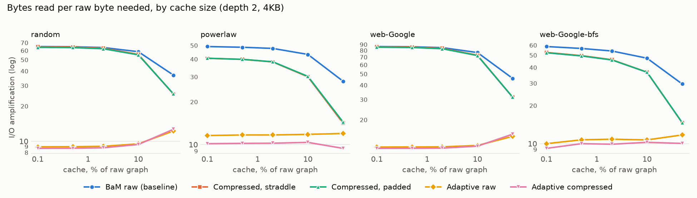
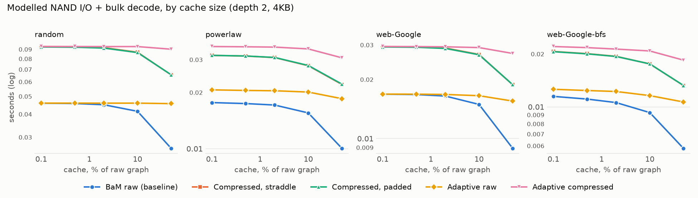
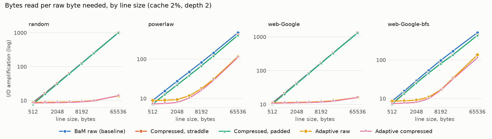
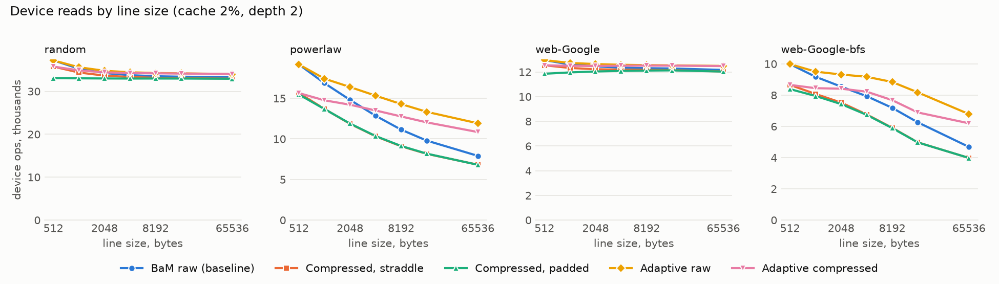
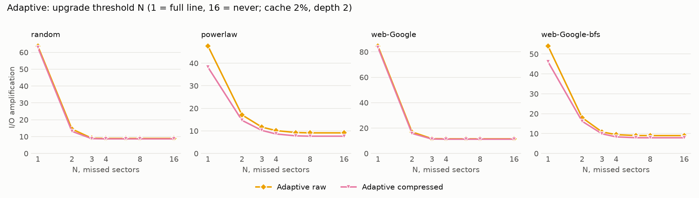
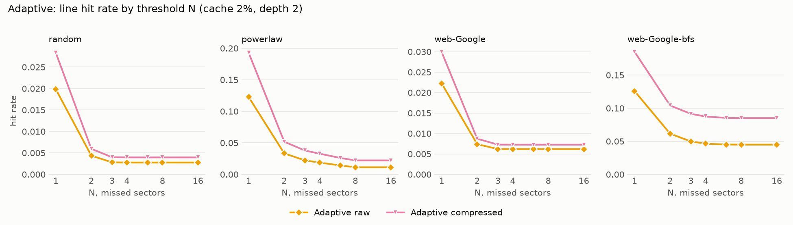
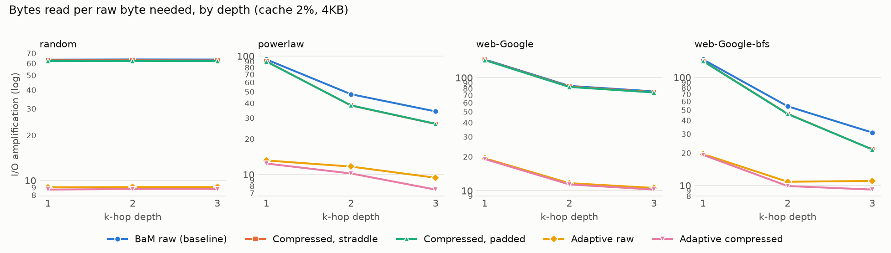

# Compressed and Adaptive Cache Lines for BaM-Style Graph Storage

**A simulation study of I/O amplification, device operations and decode cost**

Full paper: [`BaM_cache_paper.pdf`](BaM_cache_paper.pdf) · Results summary: [`RESULTS.md`](RESULTS.md)

> **Scope.** This repository measures bytes read, device operations and cache hit rates in a software
> simulator. It does not measure GPU throughput, GPU contention or real storage latency, and nothing here
> should be read as a GPU speedup claim. Storage time is modelled. The baseline is a reconstruction
> ([§10](#10-threats-to-validity)).

## Contents

1. [Abstract](#1-abstract)
2. [Introduction](#2-introduction)
3. [Background](#3-background)
4. [Design](#4-design)
5. [Methodology](#5-methodology)
6. [Validation](#6-validation)
7. [Results](#7-results)
8. [Findings](#8-findings)
9. [Discussion](#9-discussion)
10. [Threats to validity](#10-threats-to-validity)
11. [Related work](#11-related-work)
12. [Conclusion and future work](#12-conclusion-and-future-work)
13. [Reproducing the results](#13-reproducing-the-results)
14. [Repository layout](#14-repository-layout)
15. [Disclosure](#15-disclosure)
16. [References](#16-references)

## 1. Abstract

BaM gives GPUs on-demand access to NVMe storage through a software cache with fixed-size lines, and I/O
amplification (bytes read per byte needed) is a central measure of its efficiency. This study tests two
proposed improvements to raw 4 KB lines for graph neighbour lists: delta-plus-varint compressed lines, and
adaptive lines that fetch 512 B sectors and upgrade to a full line after repeated sector misses.

Using a deterministic simulator, four graphs (including the real `web-Google` dataset) and 1,700 k-hop
benchmark runs that all returned results identical to an in-memory reference, both ideas reduce bytes but
neither is a clear win:

- **Compression** reduces bytes and misses by 1.3% without ID locality, 15–20% with it, and 31–51% with a
  cache holding half the graph, but it loses on modelled total time at every practical line size.
- **Adaptive lines** cut bytes by 76–86% against raw 4 KB lines, yet a plain fixed 512 B line reads slightly
  less on all four graphs, and raw adaptive lines increase misses by 1.6–11.5%.
- **The time verdict on adaptive lines depends on the device:** modelled I/O time falls 57–69% on Optane and
  rises 2–19% on NAND.

## 2. Introduction

Graph workloads routinely exceed GPU memory. BaM [1] lets GPU threads issue NVMe requests directly and uses a
fine-grained software cache to coalesce accesses and limit I/O amplification. Its graph evaluation uses 4 KB
lines of raw data. Fixed raw lines have an obvious cost: a short neighbour list that needs a few dozen bytes
still pulls in an entire line.

Two remedies appear natural. Compressing neighbour lists packs more lists into each line, and compression is
well established for graphs [3, 5]. Fetching sectors instead of whole lines avoids transferring unused bytes,
an idea dating to sectored CPU caches [8].

### Hypotheses

- **H1.** Delta-plus-varint compressed lines reduce bytes read and misses relative to raw 4 KB lines, without
  affecting correctness.
- **H2.** Adaptive lines reduce bytes read and misses relative to raw 4 KB lines, without affecting correctness.

### Research questions

- **RQ1.** When does compression pay for its decode cost?
- **RQ2.** Does adaptive fetching beat simply using a smaller fixed line?
- **RQ3.** How sensitive are the conclusions to the storage device?

### Verdict

| Claim | Outcome |
|---|---|
| H1, bytes and misses | **Supported, conditionally.** Effect size depends on locality and cache size |
| RQ1, compression on total time | **Loses** with this decoder. It never won in the committed run, and won only at an impractical 64 KB line in faster runs |
| H2, bytes | **Supported** against 4 KB lines |
| H2, misses | **Not supported** for raw adaptive lines |
| RQ2, adaptive vs smaller fixed line | **Fixed 512 B lines read slightly less**; adaptive issues fewer device ops |
| RQ3, device sensitivity | **High.** The sign of adaptive's time effect flips between devices |
| Correctness | **Held.** All 1,700 runs matched the reference |

## 3. Background

**BaM.** BaM places a software cache in GPU memory. Threads in a warp coalesce accesses to the same line, and
one thread probes the cache for each unique line. Replacement uses a clock algorithm [2]: a global counter
assigns slots and skips those pinned by a non-zero reference count.

**I/O amplification.** For a workload:

```text
Amp = bytes read from storage / raw bytes requested by queries
```

The denominator counts 4 bytes per neighbour **for every format**, so a format cannot look better by shrinking
its own denominator. Every request counts, including repeats, so values below 1 are possible under heavy
caching. The CSVs also carry `amp_unique`, which counts each list once.

**Device limits.** Small accesses need far higher request rates to reach a given bandwidth [1]. Bytes alone do
not decide cost: fewer bytes through more requests can be slower on an IOPS-limited device.

## 4. Design

All stores share one interface. `neighbors_batch(nodes)` returns neighbours in node order plus per-node counts,
and `stats()` returns the counters. Every cached store has the same cache budget in bytes, uses line-sized
frames and applies the same replacement and coalescing rules.

| Name in paper | Name in code | Description |
|---|---|---|
| Load-all | `load_all` | Whole graph read once into RAM |
| Raw-4K | `bam_raw` | Baseline: raw `uint32` lists in fixed lines |
| Comp-S | `comp_straddle` | Compressed, lists may straddle lines |
| Comp-P | `comp_pad` | Compressed, padded to avoid straddling |
| Adapt-R | `adaptive_raw` | Adaptive fetch over raw lists |
| Adapt-C | `adaptive_comp` | Adaptive fetch over compressed lists |

### 4.1 Compressed line format

- Each neighbour list is sorted.
- The first identifier is stored as a zigzag-encoded offset from the source node; the rest are gaps.
- All values are little-endian base-128 varints.
- Per-node byte offsets stay in RAM. Degrees are not stored: a list's value count equals the number of terminator
  bytes (high bit clear) in its byte range.
- **Straddling:** list size follows from consecutive offsets, so index RAM matches the baseline, `8(n+1)` bytes.
- **Padding:** a list that would cross a boundary moves to the next line, which needs 4 more bytes per node to
  recover list lengths. Lists longer than one line must span lines either way.

Decoding is vectorised with NumPy. Terminators delimit values, payload bytes are shifted by position and summed
with `add.reduceat`, and a global cumulative sum, corrected at list heads, rebuilds identifiers. Lines are cached
compressed and decoded on read.

### 4.2 Adaptive lines

Adaptive stores use line-sized frames with a per-frame sector-valid bitmap:

```text
sector      0   1   2   3   4   5   6   7        one 4 KB frame, eight 512 B sectors
valid     [ 1 | 1 | 0 | 0 | 1 | 0 | 0 | 0 ]
needed              ^   ^           ^
                    one 1 KB read   one 512 B read      = 2 device ops
```

- A probe compares the sectors the warp needs with the bitmap and reads only absent ones, one device op per
  contiguous run.
- Each frame counts missed sectors since it was installed. At threshold `N`, all remaining sectors are fetched.
- `N <= 1` is a full-line fetch, and a very large `N` disables upgrades.
- A partly filled frame still occupies a full line, so sparse frames waste capacity.
- A probe needing any absent sector counts as a miss.

## 5. Methodology

### 5.1 Harness

Python with NumPy only; pytest and matplotlib are optional. Data files are real and are read with `pread`.

**The baseline is a reconstruction.** The original toy simulator was not available, so `bam_baseline.py`
re-implements on-disk CSR, a second-chance clock cache and warp-style coalescing from the BaM paper and a written
specification. Second-chance replacement differs from BaM's counter-only clock. Warps are simulated as groups of
32 list requests.

### 5.2 Graphs

| Graph | Nodes | Edges | Raw MB | Bytes/edge, straddle | Bytes/edge, padded | Compressed size | Padding overhead |
|---|---:|---:|---:|---:|---:|---:|---:|
| `random` | 1,000,000 | 15,999,870 | 64.0 | 2.77 | 2.78 | 69% | 0.6% |
| `powerlaw` | 1,000,000 | 11,347,768 | 45.4 | 1.56 | 1.63 | 39% | 4.4% |
| `web-Google` | 875,713 | 5,105,039 | 20.4 | 2.80 | 2.81 | 70% | 0.4% |
| `web-Google-bfs` | 875,713 | 5,105,039 | 20.4 | 1.86 | 1.87 | 47% | 0.2% |

- `random`: uniform directed graph, average degree 16.
- `powerlaw`: synthetic. Truncated-Pareto out-degrees, with 80% of edges landing near the source at heavy-tailed
  ID distance and the rest on popular global targets. Parameters are this study's own and are not fitted to a
  real graph.
- `web-Google`: real web graph from SNAP [9], in numeric ID order.
- `web-Google-bfs`: the same graph relabelled by breadth-first traversal over the undirected view, in the spirit
  of bandwidth-reducing orderings [7, 6].

All graphs are sorted and deduplicated.

### 5.3 Workload and parameters

Each run starts with a cold cache and executes 2,000 k-hop queries from uniformly random seeds, one batch per BFS
level. Five query seeds are used; synthetic graphs are fixed at generator seed 0.

One factor varies at a time around this default:

| Parameter | Default | Sweep |
|---|---:|---|
| Cache size, % of raw graph | 2 | 0.1, 0.5, 2, 10, 50 |
| Depth | 2 | 1, 2, 3 |
| Line size, bytes | 4096 | 512, 1024, 2048, 4096, 8192, 16384, 65536 |
| Upgrade threshold N | 3 | 0, 2, 3, 4, 6, 8, 99 |
| Frontier order | sorted | sorted, shuffled |

### 5.4 Metrics

- **Counted:** storage bytes, misses, hits, coalesced accesses, and the size of every device read.
- **Hit rate:** hits per unique line probe.
- **Coalesced %:** line accesses removed by per-warp deduplication.
- **Measured decode:** in-run time, one call per frontier batch.
- **Bulk decode:** a sequentially calibrated ns/edge rate times the edge count, with no per-call overhead. This
  favours compression.
- **Confidence:** the paper reports paired two-sided 95% Student-t intervals over per-seed differences (n = 5).

### 5.5 Device model

Reads come from the OS page cache, so measured wall time contains no device cost and is dominated by Python
simulation overhead. Storage time is therefore **modelled**, as a cost per device operation of size `s` bytes:

```text
t_NAND(s)   = max(1 / 750K, s / 7 GB/s)
t_Optane(s) = 1 / 5.1M + max(s - 512, 0) * (1/1.5M - 1/5.1M) / 3584
```

Rates come from BaM's device table (980 Pro: 700–800K read IOPS; P5800X: 5.1M at 512 B and 1.5M at 4 KB). The
7 GB/s NAND transfer limit is an assumption for PCIe Gen4 x4. This is a throughput model of one device, with no
queueing or latency.

## 6. Validation

- **423 pytest cases** compare every store with both load-all and an independent pure-Python BFS, across multiple
  seeds, graphs, depths, cache sizes and line sizes.
- **Edge cases:** degree-0 nodes, reads past end of file, and a hub whose list exceeds the entire cache.
- **Codec:** an independent scalar decoder cross-checks the NumPy decoder, including values at `2^32 - 1`.
- **Differential test:** the new cache code, in raw full-line mode, must reproduce the baseline's counters exactly,
  so format comparisons are not artefacts of reimplementation.
- **Runtime check:** a hash of every query result was compared with load-all for all 1,700 runs, with no mismatch.
- **Determinism:** repeated full benchmark executions produced identical bytes, misses, hits and op counts in all
  340 summary rows, including after the code-style refactor.
- **Timing is not deterministic.** See [§7.4](#74-decode-cost-and-break-even).

## 7. Results

Tables below are generated from the committed files in `results/`. Figures are in the same folder.

### 7.1 Default point

Cache 2% of the raw graph, depth 2, 4 KB lines, N = 3. Means of five query seeds.

| graph | store | storage MB | I/O amp | amp (unique) | misses | hit rate | coalesced % | decode ms (measured) | decode ms (bulk) | wall s | NAND I/O ms | Optane I/O ms |
|---|---|---:|---:|---:|---:|---:|---:|---:|---:|---:|---:|---:|
| random | load_all | 64.00 | 29.48 | 30.03 | 0 | 0.000 | 0.0 | 0.0 | 0.0 | 0.45 | 9.14 | 8.40 |
| random | bam_raw | 138.33 | 63.71 | 64.90 | 33772 | 0.020 | 0.0 | 0.0 | 0.0 | 0.61 | 45.03 | 22.51 |
| random | comp_straddle | 136.54 | 62.89 | 64.06 | 33334 | 0.028 | 0.1 | 186.5 | 47.5 | 0.82 | 44.45 | 22.22 |
| random | comp_pad | 135.10 | 62.23 | 63.39 | 32984 | 0.028 | 0.1 | 184.6 | 47.5 | 0.81 | 43.98 | 21.99 |
| random | adaptive_raw | 19.64 | 9.04 | 9.21 | 34360 | 0.003 | 0.0 | 8.1 | 0.0 | 0.65 | 45.92 | 7.02 |
| random | adaptive_comp | 19.07 | 8.78 | 8.95 | 34170 | 0.004 | 0.1 | 189.0 | 47.5 | 0.85 | 45.70 | 6.92 |
| powerlaw | load_all | 45.39 | 41.36 | 42.42 | 0 | 0.000 | 0.0 | 0.0 | 0.0 | 0.40 | 6.48 | 5.96 |
| powerlaw | bam_raw | 52.65 | 47.64 | 48.88 | 12854 | 0.123 | 42.0 | 0.0 | 0.0 | 0.47 | 17.14 | 8.57 |
| powerlaw | comp_straddle | 42.30 | 38.24 | 39.24 | 10326 | 0.193 | 49.0 | 161.1 | 17.0 | 0.63 | 13.77 | 6.88 |
| powerlaw | comp_pad | 42.41 | 38.34 | 39.34 | 10354 | 0.191 | 48.9 | 161.0 | 17.0 | 0.63 | 13.81 | 6.90 |
| powerlaw | adaptive_raw | 12.89 | 11.68 | 11.99 | 14319 | 0.022 | 42.0 | 7.4 | 0.0 | 0.49 | 20.44 | 3.67 |
| powerlaw | adaptive_comp | 11.28 | 10.22 | 10.48 | 12300 | 0.038 | 49.0 | 165.3 | 17.0 | 0.66 | 18.01 | 3.22 |
| web-Google | load_all | 20.42 | 34.15 | 40.03 | 0 | 0.000 | 0.0 | 0.0 | 0.0 | 0.33 | 2.92 | 2.68 |
| web-Google | bam_raw | 50.59 | 84.57 | 99.15 | 12352 | 0.022 | 0.1 | 0.0 | 0.0 | 0.39 | 16.47 | 8.23 |
| web-Google | comp_straddle | 49.93 | 83.45 | 97.85 | 12189 | 0.030 | 0.2 | 133.9 | 12.7 | 0.53 | 16.25 | 8.13 |
| web-Google | comp_pad | 49.52 | 82.77 | 97.04 | 12089 | 0.031 | 0.1 | 134.2 | 12.7 | 0.53 | 16.12 | 8.06 |
| web-Google | adaptive_raw | 6.98 | 11.67 | 13.68 | 12555 | 0.006 | 0.1 | 6.7 | 0.0 | 0.41 | 16.78 | 2.54 |
| web-Google | adaptive_comp | 6.80 | 11.37 | 13.33 | 12474 | 0.007 | 0.2 | 137.0 | 12.7 | 0.55 | 16.68 | 2.50 |
| web-Google-bfs | load_all | 20.42 | 33.96 | 40.07 | 0 | 0.000 | 0.0 | 0.0 | 0.0 | 0.30 | 2.92 | 2.68 |
| web-Google-bfs | bam_raw | 32.50 | 54.03 | 63.74 | 7934 | 0.126 | 28.5 | 0.0 | 0.0 | 0.35 | 10.58 | 5.29 |
| web-Google-bfs | comp_straddle | 27.72 | 46.09 | 54.37 | 6767 | 0.185 | 34.1 | 132.0 | 10.4 | 0.48 | 9.02 | 4.51 |
| web-Google-bfs | comp_pad | 27.60 | 45.89 | 54.14 | 6738 | 0.185 | 34.1 | 132.1 | 10.4 | 0.48 | 8.98 | 4.49 |
| web-Google-bfs | adaptive_raw | 6.52 | 10.84 | 12.79 | 8625 | 0.050 | 28.5 | 7.1 | 0.0 | 0.38 | 12.23 | 2.04 |
| web-Google-bfs | adaptive_comp | 5.95 | 9.90 | 11.68 | 7547 | 0.092 | 34.1 | 135.9 | 10.4 | 0.50 | 10.96 | 1.84 |

`bam_raw` shows 0 decode because its copy runs inside the baseline, untimed. `adaptive_raw`'s small value is that
same copy, not extra work.

### 7.2 Change against the baseline

Mean of per-seed changes against `bam_raw`, with the seed range in brackets. Negative is better. Break-even columns
are the bulk decode speed at which the store's I/O saving equals its decode cost; negative means there is no saving.

| graph | store | storage bytes % | misses % | device ops % | NAND I/O % | Optane I/O % | bulk-decode break-even, NAND ns/edge | break-even, Optane ns/edge |
|---|---|---|---|---|---|---|---|---|
| random | comp_straddle | -1.3 [-1.5, -1.2] | -1.3 [-1.5, -1.2] | -1.3 [-1.5, -1.2] | -1.3 [-1.5, -1.2] | -1.3 [-1.5, -1.2] | 1.1 | 0.5 |
| random | comp_pad | -2.3 [-2.6, -2.2] | -2.3 [-2.6, -2.2] | -2.3 [-2.6, -2.2] | -2.3 [-2.6, -2.2] | -2.3 [-2.6, -2.2] | 1.9 | 1.0 |
| random | adaptive_raw | -85.8 [-85.9, -85.7] | +1.7 [+1.7, +1.8] | +2.0 [+1.9, +2.1] | +2.0 [+1.9, +2.1] | -68.8 [-68.9, -68.8] | -1.6 | 28.6 |
| random | adaptive_comp | -86.2 [-86.2, -86.2] | +1.2 [+1.0, +1.3] | +1.5 [+1.4, +1.7] | +1.5 [+1.4, +1.7] | -69.3 [-69.3, -69.2] | -1.2 | 28.7 |
| powerlaw | comp_straddle | -19.7 [-20.4, -18.8] | -19.7 [-20.4, -18.8] | -19.7 [-20.4, -18.8] | -19.7 [-20.4, -18.8] | -19.7 [-20.4, -18.8] | 12.2 | 6.1 |
| powerlaw | comp_pad | -19.5 [-20.6, -18.6] | -19.5 [-20.6, -18.6] | -19.5 [-20.6, -18.6] | -19.5 [-20.6, -18.6] | -19.5 [-20.6, -18.6] | 12.1 | 6.1 |
| powerlaw | adaptive_raw | -75.5 [-76.1, -74.8] | +11.5 [+10.5, +12.5] | +19.3 [+18.6, +20.6] | +19.3 [+18.6, +20.6] | -57.2 [-57.8, -56.4] | -12.0 | 17.7 |
| powerlaw | adaptive_comp | -78.6 [-78.9, -77.9] | -4.3 [-5.3, -3.4] | +5.1 [+4.3, +6.2] | +5.1 [+4.3, +6.2] | -62.4 [-62.7, -61.7] | -3.2 | 19.3 |
| web-Google | comp_straddle | -1.3 [-1.5, -1.1] | -1.3 [-1.5, -1.1] | -1.3 [-1.5, -1.1] | -1.3 [-1.5, -1.1] | -1.3 [-1.5, -1.1] | 1.4 | 0.7 |
| web-Google | comp_pad | -2.1 [-2.5, -1.9] | -2.1 [-2.5, -1.9] | -2.1 [-2.5, -1.9] | -2.1 [-2.5, -1.9] | -2.1 [-2.5, -1.9] | 2.3 | 1.2 |
| web-Google | adaptive_raw | -86.2 [-86.3, -86.1] | +1.6 [+1.5, +1.7] | +1.9 [+1.7, +2.1] | +1.9 [+1.7, +2.1] | -69.2 [-69.3, -69.1] | -2.1 | 38.1 |
| web-Google | adaptive_comp | -86.6 [-86.6, -86.5] | +1.0 [+0.8, +1.2] | +1.3 [+1.0, +1.5] | +1.3 [+1.0, +1.5] | -69.6 [-69.7, -69.5] | -1.4 | 38.3 |
| web-Google-bfs | comp_straddle | -14.7 [-15.2, -14.3] | -14.7 [-15.2, -14.3] | -14.7 [-15.2, -14.3] | -14.7 [-15.2, -14.3] | -14.7 [-15.2, -14.3] | 10.3 | 5.2 |
| web-Google-bfs | comp_pad | -15.1 [-15.6, -14.3] | -15.1 [-15.6, -14.3] | -15.1 [-15.6, -14.3] | -15.1 [-15.6, -14.3] | -15.1 [-15.6, -14.3] | 10.6 | 5.3 |
| web-Google-bfs | adaptive_raw | -79.9 [-80.2, -79.8] | +8.7 [+8.3, +9.2] | +15.7 [+14.8, +16.6] | +15.7 [+14.8, +16.6] | -61.5 [-61.7, -61.3] | -11.0 | 21.6 |
| web-Google-bfs | adaptive_comp | -81.7 [-81.9, -81.6] | -4.9 [-5.6, -3.9] | +3.6 [+2.9, +4.7] | +3.6 [+2.9, +4.7] | -65.2 [-65.5, -64.9] | -2.6 | 22.9 |

### 7.3 Cache size





Upgrades as the cache grows, for `adaptive_raw` at N = 3:

| graph | cache % | amp | upgrades | sector misses |
|---|---|---|---|---|
| random | 0.1 | 8.96 | 4 | 37963 |
| random | 2 | 9.04 | 102 | 37851 |
| random | 10 | 9.50 | 584 | 37382 |
| random | 50 | 12.24 | 3768 | 33313 |
| powerlaw | 0.1 | 11.58 | 1338 | 19655 |
| powerlaw | 2 | 11.68 | 1482 | 19337 |
| powerlaw | 10 | 11.80 | 1664 | 18696 |
| powerlaw | 50 | 11.97 | 2331 | 15706 |
| web-Google | 0.1 | 11.61 | 5 | 13544 |
| web-Google | 2 | 11.67 | 37 | 13460 |
| web-Google | 10 | 11.99 | 184 | 13107 |
| web-Google | 50 | 14.38 | 1157 | 11081 |
| web-Google-bfs | 0.1 | 10.00 | 201 | 10861 |
| web-Google-bfs | 2 | 10.84 | 485 | 10515 |
| web-Google-bfs | 10 | 10.71 | 593 | 9840 |
| web-Google-bfs | 50 | 11.72 | 1169 | 8228 |

### 7.4 Decode cost and break-even

Calibration from the committed run:

| Graph | ns/edge | 16-list batch, µs |
|---|---:|---:|
| random | 87.5 | 42.7 |
| powerlaw | 61.3 | 44.9 |
| web-Google | 84.8 | 38.7 |
| web-Google-bfs | 69.0 | 36.6 |

Break-even decode speed for `comp_straddle` (higher is easier), and the speedup needed on NAND:

| Graph | This decoder, ns/edge | Cache 2%: NAND | Optane | Speedup needed | Cache 50%: NAND | Optane | Speedup needed |
|---|---:|---:|---:|---:|---:|---:|---:|
| random | 87.5 | 1.1 | 0.5 | 81.2× | 15.1 | 7.5 | 5.8× |
| powerlaw | 61.3 | 12.1 | 6.1 | 5.1× | 17.9 | 9.0 | 3.4× |
| web-Google | 84.8 | 1.4 | 0.7 | 58.5× | 18.6 | 9.3 | 4.6× |
| web-Google-BFS | 69.0 | 10.3 | 5.2 | 6.7× | 19.5 | 9.8 | 3.5× |

**Decoder speed varied with machine state.** The committed run measured 61–87 ns/edge. Earlier runs
of the same decoder on the same machine measured 36–52 ns/edge, which is what the paper reports, so its speedup range is
2–48× where this table gives 3.4–81×. The slower run is a whole-machine effect, not a code change:
counters were identical and the test suite slowed by a similar factor. Break-even speeds come from counters and the
device model, so they do not change. The conclusion holds across all runs: the decoder was slower than break-even
everywhere shown.

### 7.5 Line size and the fixed-line comparison





| graph | store | line | amp | hit rate | misses | device ops | Optane I/O ms | NAND I/O ms |
|---|---|---|---|---|---|---|---|---|
| random | bam_raw | 4096 | 63.71 | 0.020 | 33772 | 33772 | 22.51 | 45.03 |
| random | adaptive_raw | 4096 | 9.04 | 0.003 | 34360 | 34442 | 7.02 | 45.92 |
| random | bam_raw | 1024 | 16.64 | 0.019 | 35283 | 35283 | 9.29 | 47.04 |
| random | bam_raw | 512 | 8.78 | 0.020 | 37222 | 37222 | 7.30 | 49.63 |
| powerlaw | bam_raw | 4096 | 47.64 | 0.123 | 12854 | 12854 | 8.57 | 17.14 |
| powerlaw | adaptive_raw | 4096 | 11.68 | 0.022 | 14319 | 15330 | 3.67 | 20.44 |
| powerlaw | bam_raw | 1024 | 15.64 | 0.063 | 16869 | 16869 | 4.44 | 22.49 |
| powerlaw | bam_raw | 512 | 8.89 | 0.051 | 19170 | 19170 | 3.76 | 25.56 |
| web-Google | bam_raw | 4096 | 84.57 | 0.022 | 12352 | 12352 | 8.23 | 16.47 |
| web-Google | adaptive_raw | 4096 | 11.67 | 0.006 | 12555 | 12585 | 2.54 | 16.78 |
| web-Google | bam_raw | 1024 | 21.59 | 0.033 | 12615 | 12615 | 3.32 | 16.82 |
| web-Google | bam_raw | 512 | 11.09 | 0.043 | 12963 | 12963 | 2.54 | 17.28 |
| web-Google-bfs | bam_raw | 4096 | 54.03 | 0.126 | 7934 | 7934 | 5.29 | 10.58 |
| web-Google-bfs | adaptive_raw | 4096 | 10.84 | 0.050 | 8625 | 9175 | 2.04 | 12.23 |
| web-Google-bfs | bam_raw | 1024 | 15.63 | 0.111 | 9178 | 9178 | 2.42 | 12.24 |
| web-Google-bfs | bam_raw | 512 | 8.50 | 0.108 | 9985 | 9985 | 1.96 | 13.31 |

### 7.6 Upgrade threshold





In the charts, N = 1 is a full-line fetch and 16 stands for upgrades disabled (measured with N = 99).

### 7.7 Depth and load-all

Storage MB read, by depth:

| graph | depth | needed MB | load_all | bam_raw | comp_straddle | adaptive_raw | adaptive_comp |
|---|---|---|---|---|---|---|---|
| random | 1 | 0.13 | 64.0 | 8.1 | 8.1 | 1.2 | 1.1 |
| random | 2 | 2.17 | 64.0 | 138.3 | 136.5 | 19.6 | 19.1 |
| random | 3 | 34.92 | 64.0 | 2221.4 | 2191.2 | 315.7 | 306.7 |
| powerlaw | 1 | 0.09 | 45.4 | 8.1 | 7.8 | 1.1 | 1.1 |
| powerlaw | 2 | 1.11 | 45.4 | 52.6 | 42.3 | 12.9 | 11.3 |
| powerlaw | 3 | 13.01 | 45.4 | 435.3 | 340.0 | 121.4 | 95.9 |
| web-Google | 1 | 0.05 | 20.4 | 6.8 | 6.8 | 0.9 | 0.9 |
| web-Google | 2 | 0.60 | 20.4 | 50.6 | 49.9 | 7.0 | 6.8 |
| web-Google | 3 | 3.69 | 20.4 | 278.9 | 274.9 | 39.0 | 37.8 |
| web-Google-bfs | 1 | 0.05 | 20.4 | 6.8 | 6.6 | 0.9 | 0.9 |
| web-Google-bfs | 2 | 0.60 | 20.4 | 32.5 | 27.7 | 6.5 | 6.0 |
| web-Google-bfs | 3 | 3.60 | 20.4 | 111.3 | 77.7 | 39.7 | 33.1 |



### 7.8 Runs beating the baseline

Share of paired runs across all sweep points and seeds, excluding N ≤ 1. These shares depend on which points were
swept, and the time columns depend on the decoder speed of the run. They are not population estimates.

| store | bytes | misses | device ops | NAND total (bulk decode) | Optane total (bulk decode) | NAND total (measured decode) | Optane total (measured decode) |
|---|---|---|---|---|---|---|---|
| comp_straddle | 100% | 100% | 100% | 0% | 0% | 0% | 0% |
| comp_pad | 100% | 100% | 100% | 0% | 0% | 0% | 0% |
| adaptive_raw | 93% | 0% | 0% | 14% | 93% | 11% | 34% |
| adaptive_comp | 100% | 50% | 25% | 7% | 14% | 2% | 2% |

## 8. Findings

1. **Adaptive is roughly a fixed 512 B line with fewer device ops.** Raw 512 B lines reach amplification 8.5–11.1
   against 9.0–11.7 for `adaptive_raw`. Adaptive's advantages are 3–20% fewer device ops than 512 B lines and one
   eighth as many cache tags (tag RAM is not counted here). Upgrades did not pay for themselves in bytes:
   amplification fell as N grew and was lowest with upgrades off. They also make large caches worse. On `random`,
   upgrades rise from 4 to 3,768 and amplification from 9.0 to 12.2 as the cache grows from 0.1% to 50%.
2. **A smaller file does not by itself mean fewer reads.** `random` and `web-Google` shrink to about 70% of their
   size, yet bytes read fall 1.3%: a cold list costs about one line whatever the line's density. Compression needs
   locality (-15 to -20%, and coalescing up from 28.5% to 34.1% on `web-Google-bfs`) or a large cache (misses fall
   31% on `random` and `web-Google`, 50% on `powerlaw`, 51% on `web-Google-bfs` at a 50% cache).
3. **Reordering matters as much as encoding.** BFS relabelling cuts `bam_raw` bytes by 36% at the default point, more
   than compression achieves on that graph there.
4. **Compression loses on total time at this decoder speed.** Its I/O saving is worth 0.5–20 ns/edge depending on the
   case, and this NumPy decoder costs more than that in every run measured. With bulk decode, plain compression never won
   in the committed run and won only at 64 KB lines in faster runs. With measured decode it never won in any run.
5. **Adaptive's time effect depends on the device.** `adaptive_raw` modelled I/O falls 57–69% on Optane because small
   reads are cheaper, and rises 2–19% on NAND because a 512 B read uses the same IOPS slot as a 4 KB read and adaptive
   issues more ops. Combining adaptive with compression reads only 3–13% fewer bytes than `adaptive_raw` and pays the
   full decode cost.
6. **On-demand loading can lose to load-all, and padding hardly matters.** At depth 3, load-all reads the fewest bytes
   on all four graphs, though it needs the whole graph in RAM, which is the limit BaM exists to remove. Padding changes
   bytes by about one percentage point at most, for 0.2–4.4% more file and 50% more index RAM.

## 9. Discussion

- **Order before encoding.** Relabelling is free at query time and benefits every format.
- **Try a smaller fixed line first.** A more complex adaptive scheme has to justify itself through op counts or tag
  overhead, not bytes.
- **Revisit compression only with a much faster decoder** and a cache holding a meaningful fraction of the graph. SIMD
  integer decoders reach very high throughput [4] and one might reach the break-even range, but none was measured here,
  and a GPU decoder would face its own constraints.

## 10. Threats to validity

**Internal**

- The baseline is a reconstruction and has not been compared with the original simulator. Its replacement policy
  differs from BaM's. Differential tests show that the new and baseline cache code agree with each other, not that
  either matches BaM.
- Decode times come from up to eight concurrent workers on 24 cores and vary with machine state, so small timing
  differences should not be relied on.

**Construct**

- Storage time is a simple model, and RQ3's outcome depends on it. Real arrays, queueing and PCIe limits could change
  the balance; link-bandwidth bottlenecks would favour adaptive fetching.
- Wall time is dominated by the Python simulator.
- Hit rates are not directly comparable across formats, since stores probe different lines and adaptive partial hits
  count as misses.
- Tag and bitmap memory are not counted.
- A drive formatted for 4 KB sectors would rule out sub-4 KB reads.
- Nothing here measures GPU throughput, contention or latency.

**External**

- One real graph of about 5 million edges, smaller than BaM's targets, and one instance of each synthetic graph.
- The power-law locality parameters are unvalidated.
- Uniform-seed k-hop traversal only, with no concurrency. Skewed query popularity could increase cache value and could
  help compression.
- One factor at a time, so interactions are largely untested.

## 11. Related work

BaM [1] supplies the architecture studied here, and ActivePointers [12] is earlier work on demand paging from GPUs.
WebGraph [3] established compression that exploits locality in web graphs, and Ligra+ [5] showed that compressed graphs
can be processed in parallel in memory; this study instead asks how compression interacts with a storage-backed line
cache. Fast integer decoding is studied by Lemire and Boytsov [4]. Cache compression has been explored on-chip, for example
Base-Delta-Immediate [11]. Sectored fetch dates to the System/360 Model 85 [8], and Footprint Cache [10] applies selective
block fetching to die-stacked DRAM caches. Graph reordering is treated by Cuthill and McKee [7] and by Gorder [6].

## 12. Conclusion and future work

Neither format is a straightforward replacement for raw 4 KB lines. Compression reliably reduces bytes and misses, by an
amount governed by locality and cache size, but this decoder gives back more time than the I/O saves. Adaptive lines
greatly reduce bytes but raise misses in raw form, are matched by fixed 512 B lines on bytes, and help time only where
small reads are cheap.

Future work:

- Compare against the original baseline simulator.
- Evaluate a native or SIMD decoder.
- Test real devices and skewed workloads.
- Add larger graphs such as soc-LiveJournal1.
- Account for tag and bitmap memory.

## 13. Reproducing the results

Requires Python 3 and NumPy. pytest and matplotlib are optional. The published run used Linux, Python 3.14 and NumPy 2.5.4.

```sh
git clone https://github.com/shiv207/BaM-cacheline-study.git
cd BaM-cacheline-study

uv venv .venv --system-site-packages
uv pip install --python .venv/bin/python numpy pytest matplotlib

.venv/bin/python -m pytest -q tests

mkdir -p data/snap
curl -o data/snap/web-Google.txt.gz https://snap.stanford.edu/data/web-Google.txt.gz

.venv/bin/python bench.py
.venv/bin/python plots.py
.venv/bin/python analyze.py
```

The benchmark takes a few minutes on 8 workers and writes about 1.3 GB of images to `data/work/`, which is safe to delete.
Bytes, ops and misses should reproduce exactly on the same dependency versions; timings will not.

| `bench.py` flag | Default | Meaning |
|---|---|---|
| `--graphs` | all four | Subset of `random powerlaw web-Google web-Google-bfs` |
| `--nodes` | 1000000 | Size of synthetic graphs |
| `--snap` | `data/snap/web-Google.txt.gz` | SNAP edge list |
| `--queries` | 2000 | Queries per run |
| `--seeds` | 5 | Query seeds |
| `--workers` | 8 | Worker processes |
| `--out` | `results/` | Output folder |

**Rebuilding the paper.** Run `.venv/bin/python paper/make_tables.py`, then compile `paper/main.tex` with any LaTeX
toolchain that has `acmart`, for example `tectonic main.tex` from `paper/`.

**Using a different baseline.** All coupling to the baseline is in `BamAdapter` and `LoadAllAdapter` in `stores.py`. Edit
those two classes and rerun the tests. The differential test should fail if its cache behaves differently.

## 14. Repository layout

| Path | Contents |
|---|---|
| `bam_baseline.py` | Reconstructed baseline: CSR, clock cache, warp coalescing, load-all |
| `codec.py` | Delta and varint encoding, NumPy decoding, line packing |
| `stores.py` | `Store` interface, adapters, `CompressedBamStore`, `AdaptiveStore`, `k_hop` |
| `graphs.py` | Random and power-law generators, SNAP loader, BFS relabel |
| `bench.py` | Parameter sweep, device model, decode calibration |
| `analyze.py` | Paired comparisons, writes `results/analysis.md` |
| `plots.py` | Screen and print figures |
| `tests/` | Codec and store test suites |
| `paper/` | LaTeX source, bibliography, table generator |
| `results/runs.csv` | One row per run and seed |
| `results/summary.csv` | Means per configuration |
| `results/table.md` | Every sweep point in one table |
| `results/analysis.md` | Paired analysis |
| `results/formats.csv` | File sizes, index RAM, encode time |
| `results/decode_calibration.csv` | Decoder speed |
| `RESULTS.md` | Short results summary |

## 15. Disclosure

Generative AI was used to implement the harness, run the experiments, analyse results and draft the paper and this
document. See the paper's acknowledgments.

## 16. References

1. Z. Qureshi et al. 2023. GPU-Initiated On-Demand High-Throughput Storage Access in the BaM System Architecture. In *ASPLOS '23*, 325–339. <https://doi.org/10.1145/3575693.3575748>
2. F. J. Corbató. 1968. A Paging Experiment with the Multics System. Technical report, MIT Project MAC.
3. P. Boldi and S. Vigna. 2004. The WebGraph Framework I: Compression Techniques. In *WWW '04*, 595–602. <https://doi.org/10.1145/988672.988752>
4. D. Lemire and L. Boytsov. 2015. Decoding Billions of Integers per Second through Vectorization. *Software: Practice and Experience* 45(1), 1–29. <https://doi.org/10.1002/spe.2203>
5. J. Shun, L. Dhulipala and G. E. Blelloch. 2015. Smaller and Faster: Parallel Processing of Compressed Graphs with Ligra+. In *2015 Data Compression Conference*, 403–412. <https://doi.org/10.1109/DCC.2015.8>
6. H. Wei, J. X. Yu, C. Lu and X. Lin. 2016. Speedup Graph Processing by Graph Ordering. In *SIGMOD '16*, 1813–1828. <https://doi.org/10.1145/2882903.2915220>
7. E. Cuthill and J. McKee. 1969. Reducing the Bandwidth of Sparse Symmetric Matrices. In *Proceedings of the 1969 24th National Conference*, 157–172. <https://doi.org/10.1145/800195.805928>
8. J. S. Liptay. 1968. Structural Aspects of the System/360 Model 85, II: The Cache. *IBM Systems Journal* 7(1), 15–21. <https://doi.org/10.1147/sj.71.0015>
9. J. Leskovec, K. J. Lang, A. Dasgupta and M. W. Mahoney. 2009. Community Structure in Large Networks. *Internet Mathematics* 6(1), 29–123. <https://doi.org/10.1080/15427951.2009.10129177>
10. D. Jevdjic, S. Volos and B. Falsafi. 2013. Die-Stacked DRAM Caches for Servers: Hit Ratio, Latency, or Bandwidth? Have It All with Footprint Cache. In *ISCA '13*, 404–415. <https://doi.org/10.1145/2485922.2485957>
11. G. Pekhimenko et al. 2012. Base-Delta-Immediate Compression: Practical Data Compression for On-Chip Caches. In *PACT '12*, 377–388. <https://doi.org/10.1145/2370816.2370870>
12. S. Shahar, S. Bergman and M. Silberstein. 2016. ActivePointers: A Case for Software Address Translation on GPUs. In *ISCA '16*, 596–608. <https://doi.org/10.1109/ISCA.2016.58>
